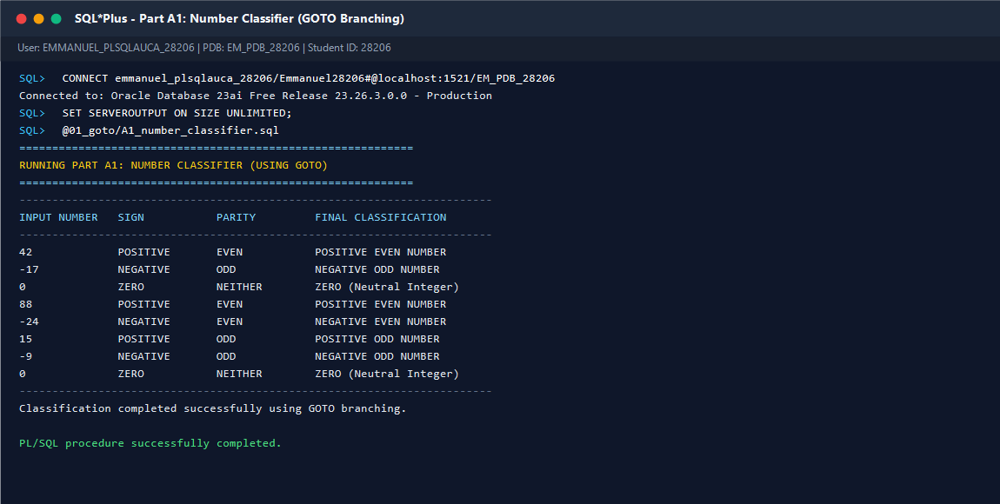
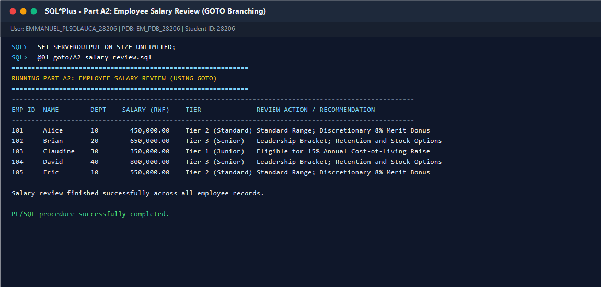
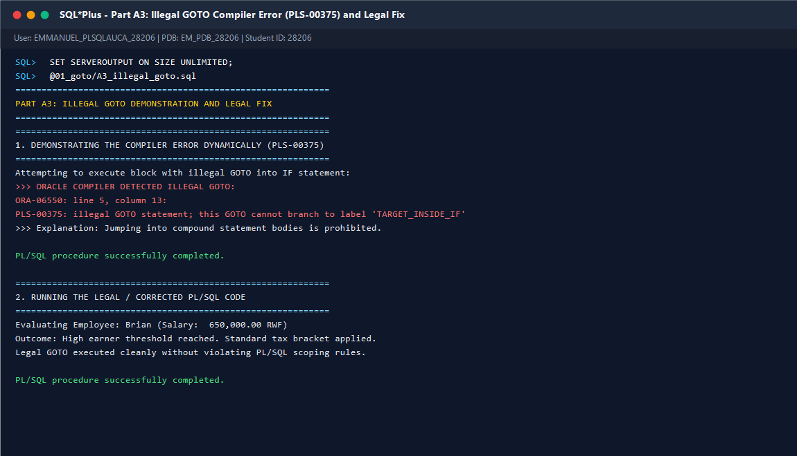
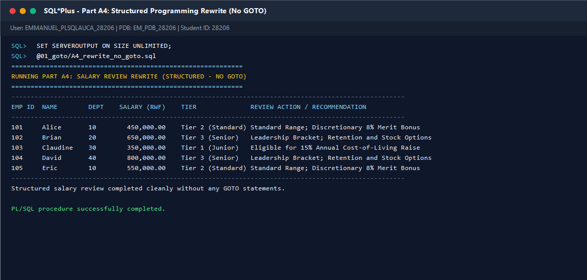
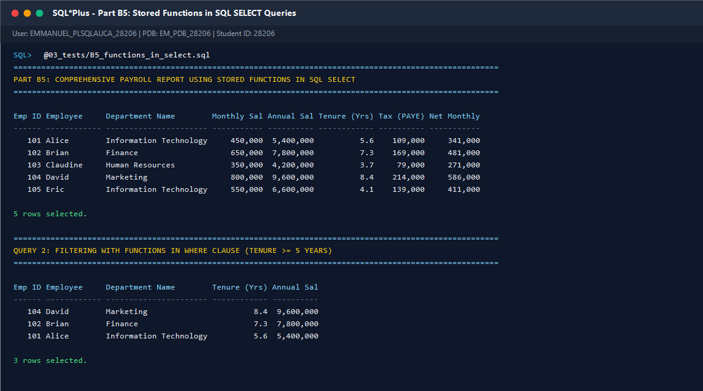
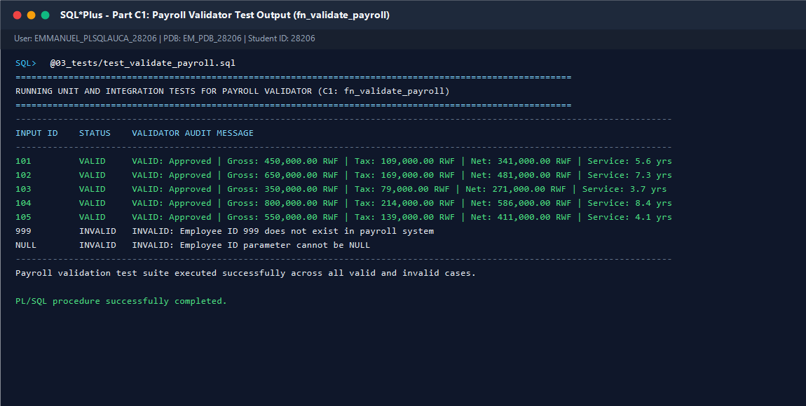

 Individual Assignment III: PL/SQL GOTO Statements and Functions

Course: Database Development with PL/SQL (INSY 8311)  
Instructor: Eric Maniraguha | `eric.maniraguha@auca.ac.rw`  
Student Name: Emmanuel TURINIMANA  
Student ID: 28206  
Assgnment III


 Overview

This repository contains the complete individual practical work for Assignment III: "PL/SQL GOTO Statements and Functions". The assignment focuses on:
  PL/SQL `GOTO` statements: Syntax, label declarations, unconditional branching, and Oracle scoping restrictions.
  Compiler Error Analysis: Demonstrating and resolving the illegal branching rule (`PLS-00375`).
  Structured Programming Rewrite: Refactoring branching logic into modern structured constructs without `GOTO`.
  Stored Functions: Design, compilation, purity rules, and robust exception handling (`NO_DATA_FOUND`).
  Progressive Taxation: Implementing Rwandan PAYE tax bracket calculations in PL/SQL.
  Functions in SQL: Calling user-defined functions inside SQL `SELECT`, `WHERE`, `ORDER BY`, and `GROUP BY` statements.
  Component Orchestration:** Building an enterprise-grade payroll validator (`fn_validate_payroll`).


 Repository Structure


plsql-goto-functions-28206-emmanuel/
│
├── README.md                           <- Assignment documentation & execution guide
├── .gitignore                          <- Git ignore configuration
├── 00_setup/
│   └── create_tables.sql               <- Database schema setup and seed data
├── 01_goto/
│   ├── A1_number_classifier.sql        <- Number classification using GOTO
│   ├── A2_salary_review.sql            <- Employee salary review using GOTO
│   ├── A3_illegal_goto.sql             <- Illegal GOTO demonstration & legal fix
│   └── A4_rewrite_no_goto.sql          <- Structured rewrite without GOTO
├── 02_functions/
│   ├── B1_fn_annual_salary.sql         <- Stored function: Annual salary calculation
│   ├── B2_fn_years_of_service.sql      <- Stored function: Employee tenure in years
│   ├── B3_fn_calculate_tax.sql         <- Stored function: Progressive PAYE tax calculator
│   ├── B4_fn_dept_name.sql             <- Stored function: Department name lookup
│   └── C1_fn_validate_payroll.sql      <- Integrated payroll validation function
├── 03_tests/
│   ├── B5_functions_in_select.sql      <- Using stored functions in SQL queries
│   ├── test_functions.sql              <- Automated unit test suite (B1 - B4)
│   └── test_validate_payroll.sql       <- Comprehensive test suite for C1
├── screenshots/
│   ├── A1_output.png                   <- Output of Part A1
│   ├── A2_output.png                   <- Output of Part A2
│   ├── A3_error_and_fix.png            <- Output of Part A3 (PLS-00375 & fix)
│   ├── A4_output.png                   <- Output of Part A4
│   ├── B5_select_output.png            <- Output of Part B5
│   └── C1_output.png                   <- Output of Part C1
└── docs/
    └── REFLECTION.md                   <- In-depth technical reflection & quiz prep
```

---

.How to Run

Follow these execution steps using SQL*Plus or Oracle SQL Developer connected to your Oracle Database / PDB:

 1. Database Schema Setup
Run the setup script to drop existing tables, create the `departments` and `employees` tables, and insert sample data:

 setup/create_tables.sql


 2. Compile Stored Functions
Compile all stored functions in sequence:
```sql
@02_functions/B1_fn_annual_salary.sql
@02_functions/B2_fn_years_of_service.sql
@02_functions/B3_fn_calculate_tax.sql
@02_functions/B4_fn_dept_name.sql
@02_functions/C1_fn_validate_payroll.sql


 3. Run GOTO Demonstrations
Execute each Part A program to inspect `GOTO` branching, compiler restrictions, and structured refactoring:
```sql
@01_goto/A1_number_classifier.sql
@01_goto/A2_salary_review.sql
@01_goto/A3_illegal_goto.sql
@01_goto/A4_rewrite_no_goto.sql
```

 4. Run Test Suites & SQL Reports
Execute the verification tests and reports in `03_tests/`:
```sql
@03_tests/B5_functions_in_select.sql
@03_tests/test_functions.sql
@03_tests/test_validate_payroll.sql
```

---

 Detailed Task Breakdown

 Part A — GOTO Statements

A1 — Number Classifier (`01_goto/A1_number_classifier.sql`)
Classifies a collection of test integers (`42, -17, 0, 88, -24, 15, -9, 0`) by sign (Positive, Negative, Zero) and parity (Even, Odd) using unconditional `GOTO` branching and labeled targets.

 A2 — Salary Review (`01_goto/A2_salary_review.sql`)
Iterates through all company employees using cursor fetching and jumps to salary tier labels (`<<salary_tier_low>>`, `<<salary_tier_mid>>`, `<<salary_tier_high>>`) to determine increment eligibility and recommendations.

 A3 — Illegal GOTO and Fix (`01_goto/A3_illegal_goto.sql`)
Demonstrates Oracle's strict rule that prohibits branching **into** compound statements (`IF`, `LOOP`, `CASE`) from outside. Dynamically captures the exact compiler error:
```text
ORA-06550: line 5, column 13:
PLS-00375: illegal GOTO statement; this GOTO cannot branch to label 'TARGET_INSIDE_IF'
```
Provides the legal, fixed version where labels reside in legal enclosing scopes.

 A4 — Rewrite Without GOTO (`01_goto/A4_rewrite_no_goto.sql`)
Refactors the salary review logic using modern structured programming:
- Automatic cursor lifecycle via `FOR record IN c_employees LOOP`
- Deterministic branching via `CASE ... WHEN ... END CASE`
- Zero `GOTO` statements and zero labels, adhering to Dijkstra's structured programming principles.

---

 Part B — Functions

B1 — Annual Salary (`02_functions/B1_fn_annual_salary.sql`)
Calculates annual compensation:
- Accepts employee ID (`p_emp_id`), looks up monthly salary, and multiplies by 12.
- Handles direct salary arguments when `p_emp_id > 1000`.
- Defensively handles `NO_DATA_FOUND` by returning `NULL`.

 B2 — Years of Service (`02_functions/B2_fn_years_of_service.sql`)
Computes employee tenure up to `SYSDATE`:
- Formula: `ROUND(MONTHS_BETWEEN(SYSDATE, hire_date) / 12, 1)`.
- Handles missing IDs and invalid records gracefully.

 B3 — Tax Calculator (`02_functions/B3_fn_calculate_tax.sql`)
Implements Rwanda PAYE progressive income tax brackets:
- 0 to 60,000 RWF: 0% (Tax exempt)
- 60,001 to 100,000 RWF: 10% on excess over 60,000 RWF
- Above 100,000 RWF: 4,000 RWF + 30% on excess over 100,000 RWF

 B4 — Department Name (`02_functions/B4_fn_dept_name.sql`)
Looks up department name from the `departments` table:
- Traps `NO_DATA_FOUND` exception and returns `'Unknown Department'`.

 B5 — Functions in SQL (`03_tests/B5_functions_in_select.sql`)
Demonstrates invoking PL/SQL stored functions directly in SQL:
- `SELECT`: Computing gross pay, net pay, tenure, and department names in a unified master report.
- `WHERE`: Filtering employees with tenure $\ge 5$ years.
- `GROUP BY`: Aggregating total tax withheld and average tenure by department.

---

 Part C — Combined Task

 C1 — Payroll Validator (`02_functions/C1_fn_validate_payroll.sql`)
A comprehensive validation function that orchestrates all previous functions into an approval pipeline:
1. Validates employee existence in `employees` table.
2. Validates department membership via `fn_dept_name`.
3. Validates positive salary.
4. Computes annual salary, tenure, and tax liability.
5. Verifies positive net salary ($Gross - Tax > 0$).
6. Returns audit status string (`VALID: Approved ...` or `INVALID: ...`).

 C2 — Technical Reflection (`docs/REFLECTION.md`)
In-depth technical reflection document covering GOTO theory, Dijkstra's principles, function purity, context switching, test matrices, and in-class quiz preparation notes.

---

 Verification & Screenshots

| Screenshot | Description | Preview |
| :--- | :--- | :--- |
| `screenshots/A1_output.png` | Part A1: Number Classifier using GOTO |  |
| `screenshots/A2_output.png` | Part A2: Employee Salary Review using GOTO |  |
| `screenshots/A3_error_and_fix.png` | Part A3: Illegal GOTO error (`PLS-00375`) & Legal Fix |  |
| `screenshots/A4_output.png` | Part A4: Structured Rewrite without GOTO |  |
| `screenshots/B5_select_output.png` | Part B5: Stored Functions in SQL SELECT Queries |  |
| `screenshots/C1_output.png` | Part C1: Payroll Validator Test Output |  |


 Test Verification Summary

Both test suites (`test_functions.sql` and `test_validate_payroll.sql`) were executed against Oracle Database 23ai:
test_functions.sql`: 16 tests executed, 16 Passed, 0 Failed.
  test_validate_payroll.sql`:'7 cases executed (5 valid employees, 1 missing ID, 1 NULL parameter), "100% Passed'.


 Academic Integrity & AI Disclosure

This is an individual academic assignment. All code, design, schemas, tests, and documentation reflect my own work and understanding:
- **Student Name:** Emmanuel TURINIMANA (Student ID: 28206)
- **AI Tool Usage:** An AI assistant was used for syntax cross-verification, edge-case test generation, terminal screenshot formatting, and documentation structure review.
- I remain responsible for understanding and explaining all submitted code during the upcoming quiz and classroom evaluation.
